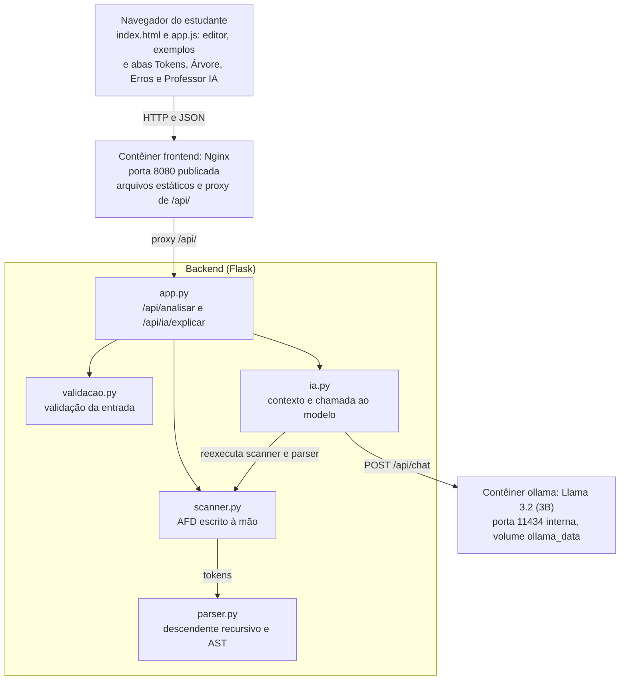
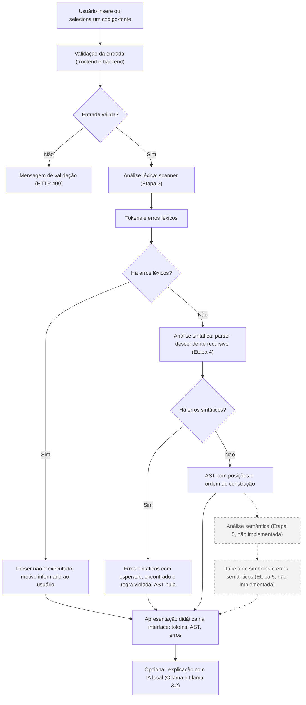

# Arquitetura

Três serviços no Docker Compose. Só o frontend publica porta (8080); o backend (5000) e o Ollama (11434) ficam na rede interna. O backend reexecuta o scanner e o parser antes de chamar o modelo, para que a IA só receba dados produzidos pelo compilador, e não o que vem do navegador.

## Fluxo do processamento

As caixas tracejadas (análise semântica e tabela de símbolos) ainda não estão implementadas; entram na etapa 5.

