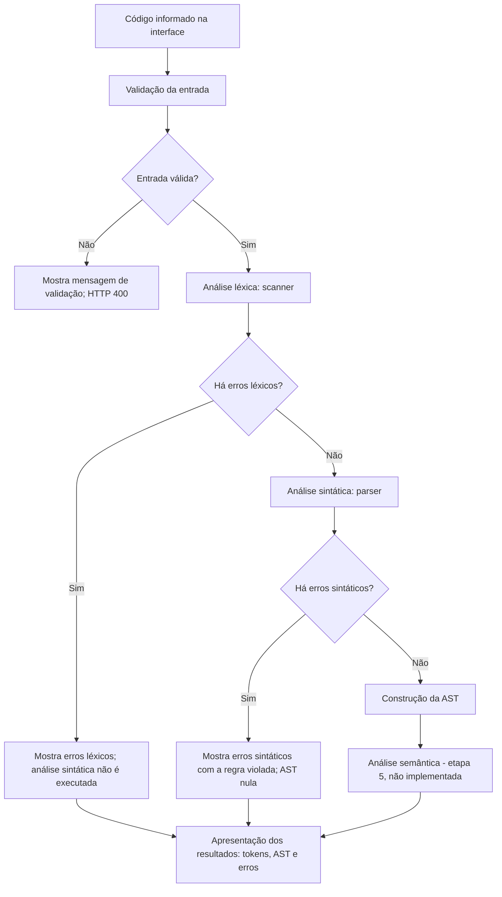
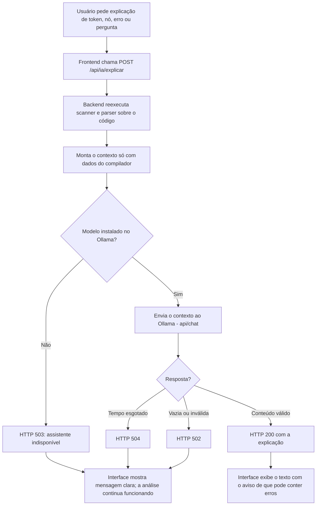

# Fluxogramas do processamento

Este documento registra, para o artigo da disciplina, o fluxo do processamento de um programa no MiniC Analisador e o fluxo da explicação com IA.

## Processamento de um programa

Do código informado até a apresentação dos resultados. A análise semântica aparece como etapa 5, ainda não implementada.

## Explicação com IA

Fluxo separado, acionado quando o usuário pede uma explicação. A análise não depende dele.

